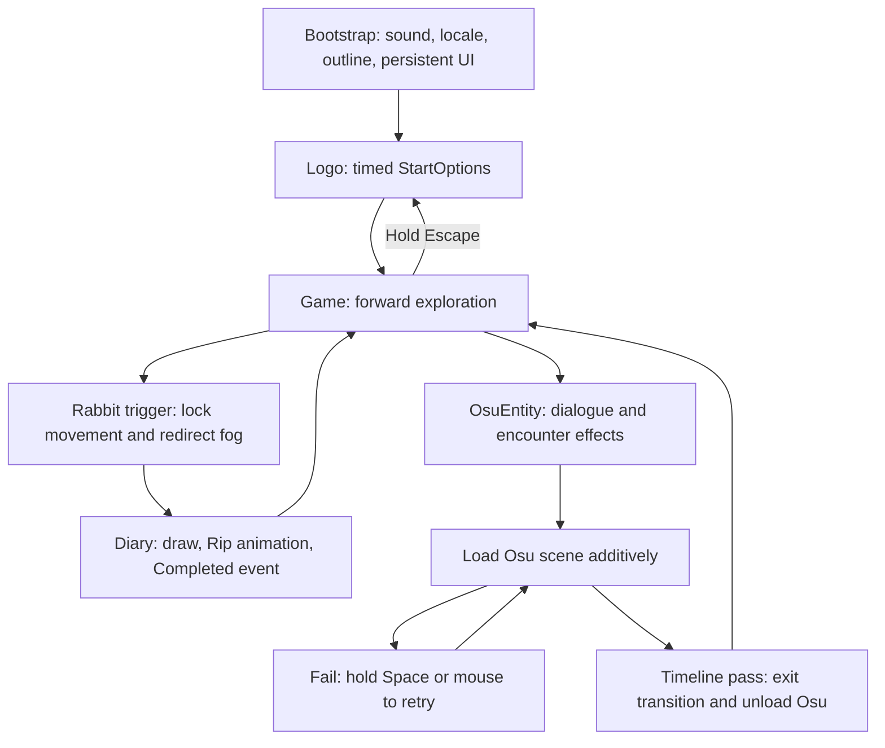
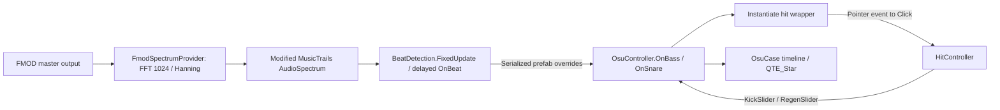

# Lisztomnezia — existing-code architecture and extension contract

> **Pause/settings implementation update (2026-10-26):** This supersedes the timed-options and held-Escape behavior described in the original audit below. Logo waits for three left mouse clicks (3x → 2x → 1x → 0x), then immediately plays the original title exit: logo fades out over 0.2 seconds and all author spheres fly to local Z=-21 over 0.4 seconds (OutExpo). There is no fixed waiting period before the animation. The original title camera and volume mask stay unchanged throughout this visible exit. After a 0.18-second fade to full black, Game loads additively; only then are menu rendering layers prepared, while covered. The title camera stays enabled until the Game MainCamera is ready, then the title presentation is disabled and Game is revealed over 0.3 seconds. The intro Animator is sampled at its final state and disabled while hidden, preventing it from replaying when the menu roots reactivate. Only the nested Logo artwork is disabled after game start; its shared parent stays active for the author spheres and decorative background. The parent CanvasGroup alpha and sphere positions are restored while hidden for later pause openings. Logo remains loaded in memory; Game becomes the active scene. LogoEntryPoint disables the original title Camera/Scroll/Canvas roots during gameplay and enables those same roots behind the pause settings, then disables them again on resume. Opening/closing in Game uses a 0.18-second fade to black and 0.25-second reveal around the live-scene switch. After the opening reveal, OpenPause replays the original author departure visibly: spheres tween to local Z=-21 over 0.4 seconds (OutExpo), non-settings title UI fades out over 0.2 seconds, and settings fade in over 0.4 seconds (InOutSine). The same effect runs directly for pause on the title screen; its closing fade is 0.25 seconds. Saved author positions and parent alpha restore when settings close, so each opening repeats the effect. The logo artwork remains disabled after game start. These animations use unscaled time. Gameplay/audio freeze immediately on opening and resume only after the closing transition finishes. Rapid pause requests are serialized, preserving the last requested state. The language dropdown closes at the start of the closing transition. On the Logo screen and in Game (including additive Osu), Esc opens the persistent settings menu and freezes scaled game time, Unity audio and the four FMOD gameplay buses. The first Esc tap leaves the menu open; releasing the next Esc press closes it. Holding Esc in the pause menu for 2 seconds quits the application (stops Play Mode in the Editor), using the existing arrow feedback and unscaled time. The <<< / << / < feedback starts only after 0.35 seconds of holding Esc in the pause menu, so a tap never flashes arrows; TMPWriter stays disabled on this manually controlled text. The dimming background has 20% overscan on each edge to cover parallax movement without resizing the controls. HypnoProfile uses moderate saturation -32 with a subtle cool tint. The menu is live scene content, with no screenshot, RenderTexture or copied backdrop. Its camera uses the MenuPresentation layer and retains its own post-processing; gameplay MainCamera stays available for encounter initialization. Gameplay canvases and volumes that were enabled are temporarily hidden and restored on resume. Title scrolling uses unscaled time to animate while gameplay is frozen. Bootstrap loads Logo with its own LocalPhysicsMode.Physics3D scene. LogoEntryPoint steps only that physics scene at 0.02-second intervals using unscaled elapsed time while its camera/root is visible; gameplay stays in the default physics scene and is never stepped by the menu. SphereController receives explicit menu steps (rather than FixedUpdate), keeps the title camera reference, and uses unscaled release waits, color fades and scale tweens. Hidden menu physics stops. The same sphere objects persist across pause openings. Settings clicks while paused never count towards the three-click game start. Resume restores the previous time scale, bus pause states and cursor state. Player/diary/rhythm input is gated while paused, retry loops wait for resume, and delayed beat notifications now use scaled waits. Existing slider/localization UnityEvents remain wired. Verified in Editor: compilation, startup with hidden settings, repeated toggle, frozen clock, paused volume control, cursor/audio restoration, release after a cancelled hold, three-click startup, title-screen pause, settings clicks excluded from startup, no arrows during short taps, delayed hold feedback, retained live title roots in game pause, third-click sphere departure, unchanged title camera/volume mask during departure, Game load under full black, restored title sphere positions/logo alpha in pause, smooth camera handoff (at least one active camera across 1453 monitored rendered frames), intermediate fade opacity, gameplay frozen through the closing animation, rapid pause requests, dropdown closing with pause, visible sphere departure with simultaneous settings fade on title and repeated game-pause openings, departure position reset on close, disabled logo retained, live background scrolling and sphere transforms at timeScale zero on both title/game pause, unchanged gameplay Rigidbody position during menu simulation, reused sphere instance IDs, no hidden-menu stepping, frozen gameplay clock, restoration of gameplay camera/UI, hidden arrows outside pause holds, background coverage at ±10° tilt, FMOD timeline freeze/resume and quit trigger; full rabbit/Osu encounter playthrough and a player build remain unchecked.

> **Mission for future AI sessions:** finish this game on its existing foundation. Preserve existing behavior, serialized wiring, timings, and content contracts. Do not turn feature work into a refactor, dependency upgrade, cleanup, or architectural migration.

This document describes the working-tree files inspected on **2026-10-26**, including existing uncommitted configuration changes. Evidence is C# source, Unity scene/prefab YAML, animation assets, and project settings. No Editor playthrough, compilation, or player build was performed for this documentation. Runtime outcomes identified below as risks are deductions from code, not reproduced failures. “Intentional design choice” means **a compatibility constraint to preserve**, not a claim that a defect was originally deliberate or that every path currently works.

Scope: all 36 C# files under `Assets/_Project/Scripts`, the four project scenes, hit prefabs and relevant animations, plus directly integrated code in EvolveGames, MusicTrails, FogPlayerAvoid, and SSH. Imported demonstration projects and every third-party internal implementation are not exhaustively audited. Re-read the relevant files before extending them; serialized values override C# defaults.

## 1. ARCHITECTURAL LANDSCAPE (For Future AI Context)

### 1.1 Actual architecture

This is a scene-driven first-person exploration game with rabbit/diary interactions and an audio-reactive osu-like challenge. There is **no project-wide gameplay state machine, dependency-injection container, or central UIManager**. Progression is distributed across trigger callbacks, `async void` methods, UniTask waits, DOTween callbacks, and animation events.

There **is** a global-namespace `GameManager` in [MusicTrails](Assets/MusicTrails/Scripts/GameManager.cs). It configures audio sources, analysis amplitude, delay, and its own pause flag. It does not own exploration, encounters, diary completion, or scene progression. Do not invent gameplay services on the assumption that this class is the game's central manager.

| Owner | Initialization / lifetime | Actual responsibility |
| --- | --- | --- |
| `BootstrapEntryPoint` | `Start`; persistent Bootstrap root | Sets locale and volume defaults, initializes sound and outline loop, loads Logo, handles held Escape globally. |
| `SoundManager` | `Instance` in `Awake`; explicit `Initialize` from Bootstrap | Owns FMOD buses and plain C# `MusicLoop`, `OsuCase`, `OsuHandleCase`; persists because it is a Bootstrap child. It has no independent persistence or duplicate guard. |
| `SSHStyleManager` | `Awake` / `OnEnable`; on Bootstrap root | Third-party persistent style singleton; supplies `SSHStyleManager.API.Outline`. Uses `SSHSystemAsset`. |
| `LogoEntryPoint` / `StartOptions` | Logo `Start`; entry root persists after options wait | Timed options sequence, static access to options, transition into Game. |
| `PlayerController` | Game `Start` | Modified EvolveGames movement, narrow camera angles, encounter camera bias; exposes `canMove`, `targetView`, velocity and running state. |
| `DialogController` | Registers into static array in `Start` | Two shared text channels: screen `[0]`, world `[1]`. |
| `DiaryController` | `Instance` in `Start` | Hands Animator, drawing cursor Rigidbody, trail feedback, animation-driven completion. |
| `RabbitEntity` / `OsuEntity` | Cache local components in `Start`; run from triggers | Temporarily own player movement, fog target and dialogue; await diary or rhythm flow. No encounter coordinator. |
| `OsuContainer` | `Awake` in additive Osu scene | Calls controller initialization, then sets global readiness flag. |
| `OsuController` | Explicit `Initialize`, not `Start` | Rhythm UI, beat-to-hit spawning, health, retry/pass loops, transitions, temporary disabling of player component. |
| `FmodSpectrumProvider` | `Instance` in `Awake`, DSP in `Start` | FMOD master-channel FFT, channel-zero spectrum. |
| `OutlineMover` / `NarrativeOutlineDirector` | Static; explicitly initialized / called | Continuous global outline changes and named narrative presets. |
| `SenseManager`, `SenseData`, `PoolPhrases` | Mostly placeholders | Sense manager's implementation is commented out. Rabbit reward fields are unused. Phrase pool only injects itself if instantiated. These are not functional progression/audio APIs. |

### 1.2 Scene and gameplay flow

Build order is executable logic, not organizational preference. Source: [EditorBuildSettings.asset](ProjectSettings/EditorBuildSettings.asset).

| Build index | Scene | Loading contract |
| --- | --- | --- |
| 0 | `Assets/_Project/Scenes/Bootstrap.unity` | Required initial scene. |
| 1 | `Assets/_Project/Scenes/Logo.unity` | Loaded singly by Bootstrap and held-Escape return from Game. |
| 2 | `Assets/_Project/Scenes/Game.unity` | Loaded singly after the timed options sequence. |
| 3 | `Assets/_Project/Scenes/Osu.unity` | Loaded additively by `StarterOsu`; requires Game and Bootstrap dependencies already alive. |



Bootstrap `Start` hides/confines cursor, selects locale index `0`, **overwrites** PlayerPrefs `bg=1`, `sfx=0.75`, `voice=0.6`, initializes sound, sets its instance/persistence, clears `OsuContainer.Initialized`, starts outline at `3`, and loads index `1`.

Logo exposes its `StartOptions` through a static property. `CheckOptions` waits 2 seconds, fades logo/moves authors, fills sliders while suppressing their write callbacks, enables interaction, then waits **20 seconds**. It does not wait for a Start button. Logo then persists its root (including Options), hides cursor, calls `OutlineMover.Initialize(0.11f)` again, and loads Game. The old commented click-count sequence is inactive.

Game has three rabbit objects (`collect_touch`, `_1`, `_2`) and one `osu_case` with serialized `lvl=1`. Source supports rhythm levels 1–3, but this scene does not establish a complete three-level progression or ending. Do not describe unused reward fields or audio assets as implemented progression.

Rabbit: Player-tagged collider → player `canMove=false` → all registered fog objects target encounter → sprite fade → `targetView=true` → first dialogue → set dialog `world=false` → await `EnterDiary` → second dialogue → restore movement/fog/noise and fade sprite. First dialogue is not awaited. Second message is not a reward-system operation.

Osu encounter: same movement/fog entrance → dialogue and `TypeWait` → for nonzero `lvl`, narrative calls and `StarterOsu.LoadAndRunGame(lvl)` → restore movement/noise/fog/cursor. `lvl=0` skips rhythm; rhythm `RunGame` itself expects sprite index `level-1`.

### 1.3 Communication and data ownership

| Mechanism | Concrete route / contract |
| --- | --- |
| Direct serialized references | Options controls; diary cursor/trails; hit UI; rhythm transition material, prefabs, sliders, positioner; cameras and player presentation. |
| Singleton/static access | `SoundManager.Instance`, `DiaryController.Instance`, `OsuController.Instance`, `FmodSpectrumProvider.Instance`, `GameManager.Instance`, `DialogController.Instances`, `LogoEntryPoint.StartOptions`. Most are not reset on destruction. |
| Static async rendezvous | `StarterOsu` starts scene load without awaiting its operation; `OsuContainer.WaitInit` waits for a boolean set after `controller.Initialize()`. Controller success returns to caller; unload is requested without awaiting completion; flag is reset afterward. |
| Scene search | Rhythm initialization uses `FindAnyObjectByType<PlayerController>()`, then `PlayerFootsteps.GiveGameScreen()`, and assigns parent Canvas camera from `Camera.main`. Serialized null `player`/`gameScreen` in Osu are expected. |
| Physics triggers | Player-tagged colliders start encounters/noise/dialogues; Diary-tagged collider drives diary zones; BigSphere tag affects author-sphere color behavior. Components are fetched from the collider GameObject, not automatically its parent. |
| Inspector UnityEvents | Logo sliders → `OnBackgroundChanged`, `OnSfxChanged`, `OnVoiceChanged`; dropdown → `OnLocaleChanged`; localized string events → `DialogBox.UpdateLocale`; hit `onClick` → its `Click`. |
| Prefab-instance event overrides | Osu `Analyzers` instance adds `OsuController.OnBass` and `OnSnare` to MusicTrails beat events. These links are not visible as C# method calls. |
| Animation events | `Animations/Hands/Ripout.anim` calls `DiaryController.Completed`, releasing an otherwise indefinite wait. |
| Shared mutable rendering | Narrative and rhythm code both write SSH outline strength; rhythm transitions mutate `RawImage.material` shader properties and temporarily assign that material to an Image. |
| Persistent settings | PlayerPrefs volume keys only in the inspected core. Bootstrap resets them each launch; locale is selected by list index. No implemented save/load progression system in this core. |

Audio-to-game data path:



There is no authored beatmap in this route. Beat callbacks assign impulses of `1`; controller Update damps them and gates spawning with thresholds, previous-frame flags and a shared cooldown. Bass uses `bassPrefabs[0]`; snare chooses index `0` or `1` from its threshold. Tail wrappers rotate 45 degrees and compensate selected child rotations. Numbers cycle after 9; an idle cooldown below `-0.9` resets the count.

### 1.4 Folder and dependency map

```text
Assets/
  _Project/
    Scenes/                 Bootstrap, Logo, Game, Osu
    Scripts/
      Common/EntryPoints/   Boot and Logo sequencing
      Common/               Slider subclass, cutout mask, billboards, UI tilt
      Managers/             SoundManager and LangManager
      HUD/                  StartOptions
      Dialog/               Shared display channels and per-object message queues
      Game/
        Diary/              Drawing and trigger zones
        Rabbit/             RabbitEntity and OsuEntity
        osu!/Hit/           Hit lifecycle and positioning
        osu!/               Additive loading, rhythm controller and cursor
        Sound/              FMOD helpers, FFT, footsteps, noise
        Effects/            Static outline loop and narrative presets
        Sense/              Data and unimplemented manager
        AuthorSphere/       Logo author interaction and curved TMP geometry
    Prefabs/Hits/           Bass_Wrapper, Snare_Wrapper, TailSnare_Wrapper
    Prefabs/Confetti/       Presentation particle prefabs
    Animations/Hands/       Diary animation state machine and completion event
    Animations/Osu/         Hit and pace animation state machines
    Presets/                Fonts, Input, Localization, Rendering
    FMOD/Amnesia_Audio/     FMOD project, metadata, source audio, Build/Desktop banks
    Sprites/, Materials/, Fonts/
  Editor/                   EntryPointSceneAutoLoader.cs
  EvolveGames/               MODIFIED player controller; not safe to replace wholesale
  MusicTrails/               MODIFIED audio analysis; GameManager and analyzer prefabs
  FogPlayerAvoid/            MODIFIED fog targeting and static registry
  SmnStyleHardline/          SSH style API, asset and rendering integration
  Plugins/                  FMOD, UniTask, DOTween, Odin and other dependencies
  AddressableAssetsData/     Localization/addressable configuration
  Resources/                Including DOTween settings
Packages/                   UPM manifest/lock plus embedded packages
ProjectSettings/            Editor version, scene order, tags, input, rendering
```

Most core code compiles into `Assembly-CSharp`; there is no project-script asmdef boundary. Folder names do not consistently match namespaces: e.g. `Game/Diary` uses `_Project.Scripts.Diary`, `Game/osu!` uses `_Project.Scripts.osu_`, `HitPositioner` uses `.Align`, `SpriteBillboard` uses `.Render`, and author/UI classes include global-namespace types. Preserve script `.meta` GUIDs and serialized field names. Some YAML `m_EditorClassIdentifier` strings reflect older namespaces; resolve `m_Script` GUID before declaring a script missing.

Recorded Editor: **6000.3.11f1**. Manifest includes URP **17.3.0**, Input System **1.19.0**, Localization **1.5.11**, uGUI **2.0.0**, Timeline **1.8.12**, Cinemachine **3.1.6**, and other packages. Presence is not proof that a package owns a gameplay subsystem. Git dependencies and embedded packages are also required; the manifest alone does not enumerate imported DLL/plugin requirements. `activeInputHandler: 2` enables both input backends: gameplay uses legacy `Input`, while the persistent EventSystem uses `InputSystemUIInputModule`.

## 2. THE "CRUTCH & MINEFIELD" MAP (Fragile Areas)

### 2.1 Strict preservation rules

| If adding… | Preserve this existing behavior | Why changing it breaks the current contract |
| --- | --- | --- |
| A scene or menu | Existing build indices 0–3 and Bootstrap-first startup | Hardcoded loads, unloads and Escape branch use numeric indices. Append unrelated scenes instead of shifting these indices. |
| A manager or scene root | Bootstrap child hierarchy (`Sound`, Canvas, EventSystem) and SSH setup | Persistence is inherited from the Bootstrap root. Sound alone never calls `DontDestroyOnLoad`. |
| An encounter | One active encounter at a time; `canMove`, `targetView`, fog and cursor ownership | Existing entities have no reentry/completion guard or global lock; overlapping sequences restore each other's state. |
| Player mechanics | Separate pitch/yaw camera transforms, forward-only traversal and scene layout | Horizontal input is forced to zero; negative vertical input is clamped to zero. Encounters assume this approach path and hardcoded camera bias. |
| Diary content/animation | `Hands` Animator, parameter spelling, `Ripout → Completed` | `EnterDiary` waits for `_exit`; `Completed` is the release gate. Removing/retiming it can strand the encounter. |
| A rhythm encounter | Additive loader/initializer ordering and existing Game player | Osu is not standalone; controller initialization dereferences player/footsteps immediately. |
| A rhythm UI or hit variant | Analyzer event overrides, hit click binding, wrapper/child structure | No automatic registration routes beats or pointer clicks into those methods. |
| Dialogue or localization | Queue order/count and channel indices | `Dequeue` throws on empty queues; rabbit consumes two entries; world/screen routing is positional. |
| Options controls | `_fill` callback suppression and names containing `Bg`, `Sfx`, `Voice` | Programmatic filling would overwrite target volumes; the Slider subclass infers its index from its name. Unknown names silently use index 0. |
| Rendering effects | Transition shader keys/material identity and existing outline writers | Multiple systems mutate shared state; changing one writer affects transitions and narrative effects. |
| Input/pause features | Legacy input axes, cursor transitions and current time-scale behavior | UniTask delays, tweens, physics and real-time beat waits do not share a uniform pause policy. |
| Plugin/content updates | Modified MusicTrails, EvolveGames and fog scripts; GUIDs | These folders are part of gameplay, not disposable stock vendor code. |

### 2.2 Startup, persistence and asynchronous hazards

- **Initialization order is a dependency.** `SoundManager.Awake` sets its singleton before Bootstrap `Start`; SSH initializes its API through `OnEnable`. Diary/dialogue instances are not ready until `Start`. New consumers cannot assume those instances exist in their own `Awake`.
- **Bootstrap is not idempotent.** Re-running it resets settings and constructs new FMOD helper instances. Its own singleton has no duplicate handling; SSH has a duplicate-root guard, but this is not a general service lifetime contract.
- **Logo roots accumulate on repeated returns.** `LogoEntryPoint` persists its root after each options sequence, with no duplicate guard or destruction path. The static options reference is overwritten on the next Logo start. Persistent Options can retain references to Logo-only objects that were destroyed.
- **Outline initialization starts another loop each time.** Both Bootstrap and Logo call `Initialize`; it clears `_disable` and starts `Run().Forget()` without cancelling an existing loop. Scenario methods with awaits can later overwrite a scenario selected by another caller. `OnDisable` does not cancel an already executing scenario's waits immediately. Preserve this baseline; do not add more initialization calls for new effects.
- **Most async work is uncancelled.** Entity methods, dialogue fades, options, diary trails, outline loops, rhythm transitions and hit tails have no scene-lifetime cancellation. Loading Logo during a pending encounter can leave work referring to destroyed Game objects. Adding scene changes inside these chains is not a supported extension point.
- **Escape is a timed global coroutine-like Update.** Starts at 2 seconds, decrements while held, recovers at four times delta time, writes `>>>`, `>>`, `>` and toggles TMPWriter. In active scene index 2 it waits 200 ms and loads Logo; otherwise it quits (or stops Editor play mode). Quit branch sets `waitDel` only after its delay, so overlapping Update invocations are possible. Osu is additive and the loader does not explicitly change the active scene.
- **Statics are not cleanly retired.** Dialog array, diary/controller/provider instances and fog registry are not cleared on destruction. Fog `Instances` only adds entries, including after Game reload. Do not assume a fresh scene implies fresh static state, especially when domain reload settings differ.

### 2.3 Diary and encounter contracts

`DiaryController.Update` polls W, LeftShift and Mouse0 even when not open; only cursor input is gated by `_isOpen`. Animation keys are `Walk`, `RunMultiplier`, `DrawSpeed`, `Draw`, `Rip`, `Transition`, `Enter`, `Exit`. FixedUpdate always writes cursor velocity and clamps it to the main camera viewport at cached Z.

`DiaryZone` uses **3D** trigger callbacks and the `Diary` tag. Primary zone calls `FillDraw` on Stay and `DropDraw` on Exit; both zones call `EnterDraw` on Enter; secondary zone Exit calls `DropDrawZone`. No replacement 2D physics contract exists here.

`FillDraw` sets `_drawZone` and increases cursor speed even before returning for Mouse0 not held. Its unusual `Mathf.Clamp(cursorSpeed, cursorSpeed * 1.004f, cursorSpeed * 100f)` effectively raises a positive speed on each Stay. Drawing multiplier reaches 12 to trigger Rip once; trail times are captured, then divided repeatedly with frame waits. A stationary held cursor gets a random velocity kick after a timer. `dotTimes` must be empty initially or match `drawDots.Length`; the Game scene starts empty and allocates it on entry. Nonempty all-zero values would restore zero trail lifetime.

`OffsetTrail` waits 60 ms, allocates point arrays, and counts progress inside the per-trail loop (42 total iterations, not 42 per trail); a zero-point trail returns from the whole method. This and the shared mutable flags affect visual timing. Game serializes **four trails**, cursor speed **0.8**, and offset **(-0.25, 0, 0)**, not the code's offset default.

Diary completion resets state and randomly awaits either `FinishRabbitSketch` or `KillEvent`, then returns to calm. The latter is a visual preset, not proof of an implemented kill/reward system. Rabbit's serialized `rewardType` and `rewardValue` are never applied.

Entities do not disable their trigger after completion. Reentering can consume exhausted dialogue queues or overlap existing work. `OsuEntity.Start` randomizes BoxCollider Z size between 5.6 and 7. Adding child Player colliders without matching controller placement can make `other.GetComponent<PlayerController>()` null.

### 2.4 Dialogue and localization

- `DialogBox.Start` splits `messageField` on newline into a FIFO, including empty entries. `TriggerMessage` calls `Dequeue()` before its null fallback; an empty queue throws rather than displaying `no message`.
- `UpdateLocale` clears/refills the queue. Mid-encounter locale changes restart queue consumption; they do not preserve progress.
- `DialogController.ShowMessage` schedules a separate fade after `text.Length * 60 ms` (or `* 200 ms` when passed a Transform), but returns after **one sixth** of that time. `TypeWait` means that short method wait finished, not that all text/fade/typewriter presentation finished.
- Shared controller fades are not serialized: an earlier message's delayed fade can clear a newer message. `personCall` is a shared one-shot flag on screen channel `[0]`.
- Position adjustment copies only supplied Z; `downY` subtracts `0.42` from the current Y, so repeated calls accumulate displacement.
- Locale index `1` halves text sizes in controller `Start`. Locale changes later do not recompute them. `LangManager` indexes the available-locale list with no bounds check or explicit initialization await. Localization settings have asynchronous initialization; do not claim locale-order/readiness validation occurred here.
- Settings/tables live in `Presets/Localization`; assets include English and Russian locales and `Localization_en-US`/`Localization_ru` tables. Serialized localized-string callbacks to `UpdateLocale` are present on all four Game encounter objects. Preserve table entries and callbacks together.

### 2.5 Rhythm, scoring and hit lifecycle

Authoritative Osu scene tuning: `hitDelay=0.4`, bass threshold `0.8`, bass damping `36`, snare threshold `0.86`, tail threshold `0.88`, snare damping `40`, both disable flags initially false, `disableImport=true`. Inspector values differ markedly from source defaults.

- Level 2 sets bass disabled/snare enabled and divides `hitDelay` by 2; level 3 enables both and multiplies delay by 2. Level 1 does not restore these fields. Current lifecycle expects a fresh additive scene/controller for each run, not repeated `RunGame` calls on one instance.
- `_read` is **not** an overall analysis switch. The condition is `!_run || (disableBass && _read)` (equivalently for snare); false `_read` bypasses the disable flag, and it defaults false initially. Do not “correct” operator precedence or infer that calling `SetReadSpectrum(false)` suppresses all beats.
- `Update` asks FMOD for timeline data even outside `_run`; `OsuCase.Initialize` creates no event. `GetDesc` ignores result codes and allocates a new float array each call. Before a level starts, handles/length may be invalid or zero. Frequency analysis likewise has startup hazards below.
- Health target starts at 1 through a 2.6-second fill tween. Miss subtracts `0.2` and clamps to `0.001..1`; reaching `0.001` sets failure. Good hit adds `0.05`, “meh” adds `0.025`. The visual slider is tweened separately from `_slider`.
- Pass is based on timeline slider reaching its maximum while `_run`, not completion of all outstanding hit animations or a score threshold. Existing pending hit tasks can still run during transitions.
- Failure changes `QTE_Star`, hides UI, shows defeat/retry text, then requires held Space/Mouse0. Power rises at `0.375/second`, falls at `3/second`; threshold is greater than 2. `RepLevel` is called before **and again inside** `RepeatTransition`. That duplicate restart is current behavior.
- Passing stops the level, transitions out, destroys hit-wrapper children, reenables the player and returns. `MusicLoop.SetPauseAmb(true)` is called at entry, but no corresponding `SetPauseAmb(false)` call exists in this core. `KillNoise` only changes `Amb_Int`; it does not unpause ambience.
- `StartTransition` turns `gameScreen` on for one frame and off again. Preserve the referenced capture/presentation object and material handoff. `OnDisable` forces `_FadingFade` and `_GaussianBlurFade` to 1.
- Hit `OnEnable` starts the shrinking pace tween immediately; it does not wait for `SetNumber`. PointerDown invokes a serialized UnityEvent, which must target `Click`.
- Hit acceptance is `pace.scale.x > 0.85 && < durationCheck`. Quality uses `checkOk`; use prefab values, not just defaults. Success does not clear `_run` for a normal hit, so repeated input before animation deactivation can repeat rewards. Miss and tail work are also not guarded as a general one-shot state machine.
- Tail loss tracks pointer Exit, not pointer Up; a click starts movement and delayed checks. It uses two `endTail` entries and CanvasGroups on tail/end. `HitController` does not destroy itself. Animation active-state curves and eventual `hitsParent` cleanup participate in lifetime. Re-enabling as a pooled object is not supported by a full state reset.
- `HitPositioner` attempts ten candidates and otherwise clamps. `_calledDelay` is set only in fallback, not on every placement; returned rotation is not a general snare rotation API. Tail rotation is separately hardcoded in the controller.

### 2.6 Audio-analysis and FMOD minefields

`AudioSpectrum` is locally modified: its Unity AudioSource `Awake` initialization is commented out and it reads `FmodSpectrumProvider.Instance.Spectrum` instead. `SAMPLE_RATE` consequently has no active assignment in that class. Frequency-index calculations can divide by zero or produce unusable ranges; null/size exceptions are swallowed only in the overall sum loop, not uniformly through analysis. Band sample slicing uses frequency numbers as array offsets in its overload. These are existing source-level defects/risks, not claims that beat detection has been verified working.

`BeatDetection.FixedUpdate` computes spectral flux, rolling history, convolution and threshold arrays, then raises delayed `OnBeat` through `WaitForSecondsRealtime`. History uses `Time.time`; playback/control code also uses scaled time. Changing time scale affects the relative timing paths. The analysis allocates arrays and removes history index 0 repeatedly; this is a meaningful per-frame cost, not an unused helper to rewrite during content work.

MusicTrails `GameManager.Awake` globally disables vSync and sets `Application.targetFrameRate=-1` when Osu loads; there is no corresponding restoration in that class. Its duplicate branch calls `Destroy(gameObject)` but still assigns `Instance=this`. Its `TogglePause` controls its Unity AudioSources, not the FMOD gameplay timeline or overall game time. The Osu instance keeps the prefab's analysis delay of 2 seconds; `loadingScreen` and realtime AudioOutput are unassigned in the inspected setup, so the imported manager's full clip-loading/demo API is not a safe general game API.

`FmodSpectrumProvider` attaches a 1024-window Hanning FFT to the **master** channel group, so analysis can include other FMOD output, not solely QTE music. It reads channel 0 and does not remove/release the DSP on destruction. FMOD event helpers generally create/start event instances without `release`; `OsuCase` recreates handles on retries. Preserve the audio mix and sequencing assumptions when adding sounds.

| Exact external identifier | Consumers / meaning |
| --- | --- |
| `bus:/bg`, `bus:/osu`, `bus:/sfx`, `bus:/voice` | SoundManager; background slider changes both bg and osu buses. |
| `event:/Music/Amb+Noise`, parameter `Amb_Int` | MusicLoop: initialize/kill-noise = 2, call-noise = 0. |
| `event:/QTE Sound/Loosing Myself` | Level 1; spelling is part of the FMOD path. |
| `event:/QTE Sound/Foggy mind` | Level 2. |
| `event:/QTE Sound/The Last Efforts` | Level 3. |
| `QTE_Star` | Rhythm start/retry/failure parameter; preserve spelling. |
| `event:/Act_QTE/Fail`, `/Hit`, `/Slide`, `/Soft Hit`, `/Start OSU` | Osu feedback events under the same `Act_QTE` prefix. |
| `event:/Player/Footsteps`, parameter `Speed` | Footsteps; player speed and `canMove` drive playback. |

`PlayerFootsteps` initially starts then pauses its event; Update stops it while idle and may recreate it while moving. 3D attributes are assigned on creation, not continually updated in this script. It also owns the rhythm `gameScreen` reference despite its audio-oriented name.

Editor/development **K** sets `Time.timeScale=10`, mutes osu bus and requests pitch `20`; release restores time scale/pitch to 1 and stored bg volume. Outline development keys 1–9 select scenarios. Do not use these controls as evidence of normal pacing.

### 2.7 Presentation, movement and build limitations

- EvolveGames controller is heavily customized. Game serializes walking/running speeds `1.6/2.6`, jump speed `0`, look speed `0.2`, pitch/yaw limits `12/16`, crouch key `0`, `Items=null`, wall-hiding disabled. Its generic item/ladder branches still dereference `Items`; enabling those paths is not safe merely because the vendor script contains them. `Ladder` is checked in code but is not among the custom tags currently recorded.
- `canMove=false` gates horizontal/vertical input and jumping, not the entire controller, gravity, look or crouch logic. Osu separately disables the whole component. `targetView` biases pitch/yaw toward approximately `8.23/-2.24` with random movement; it does not actually look at the encounter Transform.
- Fog objects serialize `minDistance=25`, `maxDistance=-3`, interval `0.4`; these are deliberate baseline values to preserve, not conventional distance bounds to normalize. `NewView` and `ReturnView` launch uncancelled interpolations that can compete.
- `SpriteBillboard` runs in edit mode and LateUpdate for many environment sprites, within 25 units. It rotates toward **negative** camera direction with no Y-only constraint. `TMP_Curve` also runs in edit mode and rebuilds TMP geometry every Update. Their orientation and animation costs are part of presentation.
- `UITilt` returns completely if `chtoRaw` is empty; if nonempty it assumes at least **four** entries. `UITiltR` does not have this array gate. Both overwrite local position/rotation; `chto` decides whether offsets preserve the recorded pose. Do not add a second transform writer casually.
- `CutoutMaskUI.materialForRendering` creates a fresh material with stencil comparison `NotEqual` on every access and does not destroy it. Do not replace this component with a plain Image when extending masks.
- Author spheres use 3D Rigidbodies and physical bounds. Small-sphere async work is invoked from FixedUpdate, waits using a previously captured distance and does not recompute it afterward; overlapping continuations are possible. Big-sphere trigger handling has no type filter, assumes `ppp[0..1]`, scales incoming/outgoing objects to 8/12, grows by 1.12 and shrinks by 1.1. Stored saturated colors may not equal colors removed later, especially when small-sphere exit changes them. Several color helpers are unused. Preserve this logo interaction without interpreting it as general inventory/absorption logic.
- `BootstrapEntryPoint.cs` has an unconditional `using UnityEditor;` outside an Editor folder, although its `EditorApplication` call is guarded. This is a **player-build compatibility risk**. No player build was run; this README does not certify buildability.

## 3. EXTENSION BLUEPRINT (How to add new features)

### 3.1 Procedure for every feature

1. Identify its owning scene and lifetime: Logo options, Game exploration/encounter, or additive Osu. Start from the specific existing component and its serialized scene instance, not a proposed central manager.
2. Read the component, its callers, `.meta`, referenced prefab, Animator and UnityEvents. Search both C# and YAML: a missing C# call does not mean a method is unused. Record scene values before copying anything.
3. Put additive project behavior under the matching `Assets/_Project/Scripts` area. Match actual namespace conventions; retain existing GUIDs and field/method names on existing assets. A new class can own its own state without taking over existing state machines.
4. Bind scene objects explicitly in the Inspector where possible. Use existing static services only after their actual initialization phase. `SoundManager.Instance != null` alone does not prove `Initialize()` has constructed its helpers.
5. Schedule interaction in an idle exploration segment. There is no global busy flag. New local busy guards only protect the new feature; they do not prevent an existing rabbit/Osu trigger from firing. Placement and serialized trigger geometry remain part of coordination.
6. Own and clean up only the new feature's subscriptions, tweens and tasks. Do not use global tween cancellation, reset manager singletons, reinitialize sound/outline, or rewrite existing task lifetimes as a side effect.
7. Preserve the existing scene sequence and check the specific integration path from Bootstrap. Compare against the unchanged baseline, including known defects, so a new failure is not confused with an old one.

### 3.2 Adding exploration mechanics or encounter content

For passive world behavior, add a separate scene component that uses explicit references and does not change `canMove`, `targetView`, cursor, scene state or shared dialogue unless required by the mechanic.

For another rabbit encounter, duplicate the complete existing `collect_touch` hierarchy in Game, preserving trigger collider, sprite child, dialogue component/localization callback and noise child. Place it where it cannot overlap an existing encounter. Supply at least two queued lines in every locale; leave `onTrigger=false` when `RabbitEntity` owns invocation. Keep the original world-first/screen-second sequence and existing diary dependency. Changing reward fields alone has no gameplay effect.

For another rhythm encounter, duplicate `osu_case` with its components and callback wiring. Use an already supported level 1–3, preserve `lvl=0` only for intentional dialogue-only behavior, and let `StarterOsu` own load/run/unload. Do not load Osu in advance or run two controllers concurrently. A truly new level requires coordinated explicit additions to `OsuCase` event selection, `lvlSprites`, content and difficulty behavior; array growth alone does not add a level.

For new narrative visuals, call the existing narrative preset API at an encounter boundary that already owns the outline. Do not call `OutlineMover.Initialize` from a feature. Existing outline scenarios are not a queue and do not provide exclusive ownership or immediate cancellation.

### 3.3 Adding UI, dialogue and hit content

The runtime UI is **uGUI/Canvas with TMP**, not a UI Toolkit screen system. Extend the appropriate scene Canvas while preserving its render mode, camera, sorting, raycast and CanvasGroup settings. Use the persistent EventSystem supplied by Bootstrap rather than adding another EventSystem to additive content.

For options, retain the Bg/Sfx/Voice SliderEvents naming contract and the exact value callbacks. `_fill` is necessary during animation. The options screen auto-advances; adding an interactive control does not implicitly extend its 20-second window. Locale indices must correspond to the configured locale list.

For dialogue, add text to the existing localization collection and wire the corresponding localized-string event into the object's `UpdateLocale`. Verify newline count and order per language. A scene-local message adapter can use channel `[0]` or `[1]`, but it must be invoked when that shared channel is free; no dialogue lock service exists. Do not assume `TypeWait` means visual completion.

For hit visuals, duplicate the nearest complete hit wrapper and its presentation assets, preserving the RectTransform wrapper, `HitController` descendants, Animator references, CanvasGroups, pace/core/text references, click UnityEvent and tail endpoints where applicable. `bassPrefabs` uses only slot 0; `snarePrefabs` uses slots 0 and 1. Extra array entries are not automatically selected. Keep animator triggers `click`, `miss`, and `drop` and the existing active-state curves.

### 3.4 Minimal additive-feature adapter (illustrative C#)

This template is **not an existing project API**. It demonstrates a small scene-local UI/sound feature using real services without creating managers. Invoke `Activate` from a serialized UnityEvent in an otherwise idle segment. It adds its own cancellation and reentry guard; it makes no claim to coordinate the existing encounters.

```csharp
using System;
using System.Threading;
using _Project.Scripts.Managers;
using Cysharp.Threading.Tasks;
using UnityEngine;

namespace _Project.Scripts.Game.Features
{
    public sealed class ExtraFeatureAdapter : MonoBehaviour
    {
        [SerializeField] private GameObject featurePanel;
        private CancellationTokenSource lifetime;
        private bool busy;

        private void OnEnable() => lifetime = new CancellationTokenSource();

        // Bind this method in the new feature's Inspector event.
        public void Activate()
        {
            if (!isActiveAndEnabled || busy || featurePanel == null) return;

            var sound = SoundManager.Instance;
            // A singleton reference alone is not the initialization contract.
            if (sound == null || sound.MusicLoop == null ||
                sound.OsuHandleCase == null) return;

            busy = true;
            RunFeature(sound, lifetime.Token).Forget();
        }

        private async UniTask RunFeature(SoundManager sound, CancellationToken ct)
        {
            try
            {
                featurePanel.SetActive(true);
                sound.OsuHandleCase.SSoftHit(); // Existing feedback, if appropriate.
                await UniTask.Delay(600, cancellationToken: ct);
                // Apply only this feature's local result here.
            }
            catch (OperationCanceledException) { }
            finally
            {
                if (featurePanel != null) featurePanel.SetActive(false);
                busy = false;
            }
        }

        private void OnDisable()
        {
            lifetime?.Cancel();
            lifetime?.Dispose();
            lifetime = null;
            if (featurePanel != null) featurePanel.SetActive(false);
        }
    }
}
```

Assign a panel separate from the adapter's own GameObject so hiding it does not disable the owner unintentionally. If a mechanic needs movement lock, diary, dialogue or a scene change, use the specific ownership sequence above instead of expanding this example into a new global manager. This example has not been compiled as part of the documentation task.

## 4. QUICK START & INITIALIZATION

### 4.1 Open and start the existing project

1. Open the repository root with Unity **6000.3.11f1**, matching [ProjectVersion.txt](ProjectSettings/ProjectVersion.txt). Let the existing packages/plugins import with the checked-in manifest and lock file; this document does not require upgrades.
2. Confirm the four enabled scene indices in section 1.2. Use **Bootstrap** for a fresh session.
3. The Editor helper [EntryPointSceneAutoLoader.cs](Assets/Editor/EntryPointSceneAutoLoader.cs) sets `EditorSceneManager.playModeStartScene` to build-settings slot 0. It defaults enabled via EditorPrefs `EntryPointSceneAutoLoader.Enabled`; menu: **Tools → Entry Point Scene Auto Loader → Toggle**. If disabled, pressing Play in Game/Osu bypasses required initialization. A `Set Entry` constant exists but has no separate MenuItem implementation.
4. Confirm the Bootstrap hierarchy and dependencies below are intact. Do not instantiate vendor player/manager prefabs as substitutes for scene-authored objects.
5. Confirm FMOD imports its project/banks. [FMODStudioSettings.asset](Assets/Plugins/FMOD/Resources/FMODStudioSettings.asset) points to `Assets/_Project/FMOD/Amnesia_Audio/Amnesia_Audio.fspro` and bank source `Assets/_Project/FMOD/Amnesia_Audio/Build`. Desktop bank files are physically present in this workspace: Master, Master.strings, Appears, Menu_Sound, Music, OSU Action, Player, QTE sound and Speech. Availability in another checkout/platform and successful runtime loading still require verification.
6. Enter Play. Expect Logo/options to advance automatically after its animations and timed window. W moves forward; Shift runs when allowed; mouse look is constrained. Diary uses mouse movement and Mouse0. Rhythm uses pointer hits and held Space/Mouse0 for retry. Holding Escape returns from active Game to Logo, otherwise quits.

### 4.2 Essential scene-authored hierarchy

**Bootstrap** has two roots, `Camera` and `Bootstrap`, and **no prefab instances**. The persistent `Bootstrap` root carries `BootstrapEntryPoint` and `SSHStyleManager` and contains `Sound` (`SoundManager`), Canvas with Escape TMP text/TMPWriter, and EventSystem/InputSystemUIInputModule. `escText` must reference the persistent text. SSH's system asset and the project's rendering configuration must remain assigned. The camera is scene-local, not the lifetime owner of those services.

**Logo** roots are `Camera`, `LogoEntryPoint`, `Scroll`, `Canvas`; also scene-authored, with no prefab instances. `LogoEntryPoint/Options` hosts StartOptions and its panel/sliders/dropdown hierarchy. Its `logo` and `authorsParent` references point into the logo presentation, with author spheres/TMP curves under `Canvas/Logo/authors`. The Options root persists with LogoEntryPoint; the presentation roots do not automatically persist.

**Game** roots are `Player`, `Canvas`, `Effects`, `Game`, `GameEntryPoint`, `Dialog World`; no prefab instances were found in its YAML. A GameObject named `GameEntryPoint` does not establish a C# gameplay entry manager.

| Game object / subtree | Required coupling |
| --- | --- |
| `Player` | Player tag, CharacterController, modified PlayerController, PlayerFootsteps with player/gameScreen assignments. |
| `Player/HCam` and camera subtree | Separate PlayerController `Camera` and `HCamera` references; usable MainCamera for diary/world/UI calculations. |
| `Player/HCam/Hands` | DiaryController + Hands Animator; referenced drawing Rigidbody and four TrailRenderers. |
| `Hands/left/Sprite Mask` and `Sprite Mask_1` | Primary/secondary DiaryZone trigger hierarchy; Diary-tagged cursor collider/Rigidbody relationship. |
| `Canvas/Dialog` | Screen DialogController (`world=false`), CanvasGroup, message and personMessage. |
| `Dialog World/Dialog` | World DialogController (`world=true`), CanvasGroup and message. |
| `Game/collect_touch`, `_1`, `_2` | RabbitEntity, queued/localized DialogBox, collider, child sprite and noise trigger. |
| `Game/osu_case` | OsuEntity level 1, localized person/screen dialogue, collider, sprite and noise trigger. |
| `Game/Terrain_Fog_FX_v2_Tip_1`, `_2` | Fog-target components with Player transform and particle renderer/shader properties. |

**Osu** has root `osu!`. `OsuContainer.controller` points to `osu!/Core/Game` (`OsuController`, CanvasGroup/Image); `Positioner`, hits parent, transition RawImage/material, health/time/speed UI, retry/defeat texts, three level sprites and cursor hierarchy must remain linked. `osu!/Analysis/SpectrumProvider` provides FMOD FFT. `disableImport=true` hides the referenced import/debug UI, not an instruction to remove the analysis graph.

Osu's four prefab instances are:

- `Assets/MusicTrails/Prefabs/Essentials/GameManager.prefab` — scene overrides assign early/realtime spectrum references; bare prefab fields are null.
- `Assets/MusicTrails/Prefabs/Essentials/Analyzers.prefab` — nested spectrum assets and beat components; scene overrides bind OnBass/OnSnare to this OsuController.
- `Assets/MusicTrails/Prefabs/BandBars.prefab` and `GraphCanvas.prefab` — analyzer visualization/imported presentation. Their presence does not mean they own gameplay.

Runtime-spawned content references are `Assets/_Project/Prefabs/Hits/Bass_Wrapper.prefab`, `Snare_Wrapper.prefab`, `TailSnare_Wrapper.prefab`, in that bass/snare array ordering. Removing analyzer debug visuals without tracing nested references is not a documentation-authorized cleanup.

### 4.3 Integration verification matrix

These are **checks to perform after a future feature**, not tests reported as passing in this audit.

| Path | Observe |
| --- | --- |
| Fresh Bootstrap → Logo → Game | No missing service references; volume fill/callbacks; automatic transition; persistent UI input; main camera and movement. |
| One rabbit through completion | Both dialogue lines, drawing-zone transitions, trail behavior, Ripout event, movement/fog restoration. |
| Osu entry and normal hits | Additive initialization, transition capture, spectrum callbacks, expected wrappers, health feedback and cursor behavior. |
| Osu failure/retry/pass | Hold retry, restart timing, completion/unload, restored player; distinguish known ambience-pause behavior from regressions. |
| Locale selection | Both channels, font sizing, localized queue line count/order, options callback wiring. |
| Escape and repeat entry | Track persistent Logo roots, stale fog/static references and pending async work; this path already carries hazards. |
| Player build, if shipping is in scope | Compile/import/plugin/platform compatibility separately from Editor play success; UnityEditor import risk remains unverified. |

The architecture to preserve is the combination of **code + scene hierarchy + serialized events + animation events + FMOD identifiers + numeric scene order**. No individual script is a complete description of a feature's behavior.
